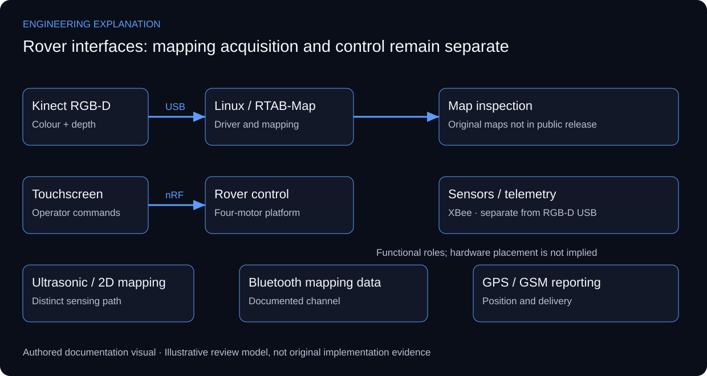

# Reconnaissance Robot — RGB-D Mapping & Remote Control

## Separating mapping, command and telemetry paths

The rover combines four-motor motion, Kinect RGB-D acquisition, RTAB-Map on Linux, ultrasonic sensing, a touchscreen controller and several communication channels. Its documented integration issue was software-build and Kinect-driver compatibility. The wired USB depth-data path was retained; it should not be redrawn as a wireless video feed.

RGB and depth observations need a consistent sensor configuration before mapping is interpreted. RTAB-Map provides graph-based mapping and loop-closure functionality, but citing its capabilities does not establish which parameters were enabled on this rover. The public source documents the RGB-D integration, not a recovered launch file, a measured map accuracy or a demonstrated loop-closure benchmark.

The touchscreen and nRF command path, XBee sensor telemetry, Bluetooth mapping data and GPS/GSM reporting have distinct roles. Mapping acquisition failure therefore cannot be diagnosed from the control channel alone. A reference integration review isolates each interface, then checks how observations and commands are associated with the correct source and time.

A useful mapping demonstration would pair the input sensor view with the produced map and acquisition conditions. Original build photographs, captured point clouds and operating logs are not in the available public release. The existing rover illustration and the interface review below explain the actual documented scope; neither is a substitute for those records.

*New explanatory responsibilities and review criteria; not an as-built drawing or new test result.*

## Review scenarios and expected evidence

These are review criteria, not additional completed tests.

| Review area | Method | Evidence to inspect |
|---|---|---|
| RGB-D acquisition | Confirm colour/depth availability and calibration context | Paired sensor capture and configuration |
| Remote control | Exercise command reception separately from mapping | Command/action record; no invented response time |
| Sensor telemetry | Trace the stated XBee and sensor path | Source identity and sample sequence |
| GPS/GSM reporting | Distinguish position acquisition from message delivery | Position status and delivery record |

## Primary technical references

- [RTAB-Map — official project documentation](https://introlab.github.io/rtabmap/)

References support the explanation, not undocumented implementation claims.

No physical-build photograph or measured point-cloud result has been reconstructed from a generated illustration.

[Published case study](https://mahyoub88.github.io/projects/proj-reconnaissance-robot/).
